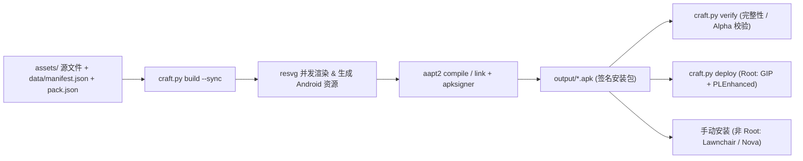

# MonetCraft

[](https://github.com/DotRedstone/MonetCraft/actions/workflows/build.yml)

**通用 Android 图标包补全框架 + AI Workspace Skill + GitHub Actions 云端自动出包**。

MonetCraft 用于为任意主流 Android 图标包无缝补齐缺失的第三方应用图标。无论你使用 **Material You 动态双色**（Pix Material You / Lawnicons）、**彩色自适应**（Pixel / One UI / HyperOS / Nothing），还是 **异形 / 线条 / 扁平全彩**（Delta / LineX / Whicons / Crayon），只需维护轻量源文件，即可本地或通过 GitHub Actions 一键构建签名 APK，并配合 [Global Icon Pack](https://github.com/richardluo/globalIconPack) (GIP)、Pixel Launcher Enhanced (`PLEnhanced`) 或 Lawnchair / Nova 等第三方启动器即时生效。

---

## 目录

- [一、为什么是「框架 + Skill」架构](#一为什么是框架--skill架构)
- [二、快速上手](#二快速上手)
- [三、支持的三种图标风格](#三支持的三种图标风格)
- [四、配置与数据规范](#四配置与数据规范)
- [五、CLI 全量命令速查](#五cli-全量命令速查)
- [六、本地环境安装指南](#六本地环境安装指南)
- [七、手机端安装与生效方式](#七手机端安装与生效方式)
- [八、云端自动构建与 AI Agent 协作](#八云端自动构建与-ai-agent-协作)
- [九、常见问题排查 (FAQ)](#九常见问题排查-faq)

---

## 一、为什么是「框架 + Skill」架构

项目按职责清晰拆分为三层，**核心代码零个人硬编码**：

1. **框架层 (`craft.py` + `core/`)**：100% 确定性的本地/CI 工程引擎，负责设备巡检、组件匹配、多风格图标导入/矢量化、并发重渲染、APK 隔离编译签名、GIP 数据库热注入与质量校验。
2. **数据层 (`pack.json` + `data/` + `assets/`)**：声明式配置与单一源文件仓库（Single Source of Truth）。所有 `output/` 与 `android/res/` 均由 `craft.py build --sync` 自动重建，Git 仅追踪轻量矢量/源图与配置。
3. **Skill 层 (`.agents/skills/monetcraft/`)**：面向 AI Coding Agent 的渐进式工作流与视觉规范，指导 Agent 自动识别设备当前宿主图标包、采样宿主风格 DNA、绘制/导入、本地校验并零残留部署。



### 目录结构

```text
MonetCraft/
├── craft.py                              # 统一 CLI 主入口
├── pack.json                             # 声明式图标包配置 (包名、风格、色板、签名、动态包名规则)
├── core/                                 # 通用框架引擎 (零个人特判)
│   ├── config.py                         # 路径常量、pack.json 与 manifest.json 读写
│   ├── env.py                            # 跨平台工具链动态探测 (magick / potrace / resvg / aapt2 / android.jar)
│   ├── adb.py                            # 统一 ADB 通信、多设备嗅探与零残留拉取
│   ├── resolver.py                       # 组件解析、模糊容错与声明式动态随机包名探测
│   ├── vectorizer.py                     # 多风格资源处理 (monet 矢量化/多层 SVG、adaptive、bitmap)
│   ├── builder.py                        # SVG/PNG 并发同步、appfilter 生成与零污染隔离编译签名
│   ├── deployer.py                       # APK 覆盖安装、GIP 数据库热注入与 Launcher 缓存重置
│   └── auditor.py                        # 设备宿主包与覆盖率巡检、APK 校验、实机缓存拼图导出
├── .agents/skills/monetcraft/            # Antigravity / 通用 Workspace Skill
│   ├── SKILL.md                          # 端到端 AI 巡检 -> 制作 -> 校验 -> 部署 SOP
│   └── references/
│       ├── style-monet.md                # Material You / PashaPuma 动态双色 Alpha 与居中规范
│       ├── style-general.md              # 非 MD3 图标包 (Delta/LineX/HyperOS 等) 风格匹配与导入指南
│       └── android-stack.md              # PLEnhanced + GIP 双栈原理与设备零残留规范
├── .github/workflows/build.yml           # GitHub Actions 21 秒云端自动打包签名
├── assets/                               # 图标源文件目录 (单一数据源，Git 跟踪)
├── data/
│   ├── manifest.json                     # 已收录应用清单 (含可选单图标 style 与声明式 aliases)
│   └── components.json                   # 离线应用组件索引库
├── android/
│   ├── AndroidManifest.xml               # 包清单模板 (由 pack.json 自动同步)
│   └── assets/                           # 标准 appfilter.xml 与 drawable.xml (不含设备私有随机包名)
├── tools/
│   ├── apksigner.jar                     # APK 签名工具
│   └── release.jks                       # 默认签名密钥库
└── AGENTS.md                             # 仓库硬性工程边界约束
```

---

## 二、快速上手

### 场景 A：基于当前仓库直接编译 / 补图标

```bash
# 1. 从 assets/ 源文件重建资源并编译签名 APK (约 2 秒)
python3 craft.py build --sync

# 2. 校验 APK 资源完整性与 Monet 多层 Alpha 质量
python3 craft.py verify

# 3. 连接已 Root 且装有 GIP 的手机，巡检未适配应用
python3 craft.py audit

# 4. 导入新图标并立即热部署到手机
python3 craft.py import /path/to/icon_mono.svg com.example.app "示例应用" --deploy
```

### 场景 B：复用本框架，为任意其他图标包建一套专属补全包

只需 3 步，无需改动任何 Python 代码：

1. 编辑 [`pack.json`](pack.json)：修改 `package_name`、`label`、`apk_output` 与默认 `style`（例如做 `Delta` / `LineX` 补全包设为 `"bitmap"`，做 `HyperOS` / `One UI` 设为 `"adaptive"`）。
2. 清空内置图标记录（保留框架与基础 logo）：
   ```bash
   python3 craft.py reset
   ```
3. 逐个导入你的图标（SVG 或透明 PNG 均可）：
   ```bash
   # 例：异形/线条包 (Delta / LineX / Whicons)
   python3 craft.py import my_icon.svg com.example.app "示例应用" --style bitmap --deploy

   # 例：彩色自适应包 (Pixel / HyperOS / One UI)
   python3 craft.py import my_fg.svg com.example.app "示例应用" --style adaptive --bg "#1E88E5" --deploy
   ```

### 场景 C：无本地 Android SDK，纯云端出包

Fork 本仓库后，直接将新图标放入 `assets/` 并在 `data/manifest.json` 追加条目，推送到 `main` 分支即可自动触发 [`.github/workflows/build.yml`](.github/workflows/build.yml)，约 20 秒后在 **Actions → 最新 Run → Artifacts** 下载签名好的 `monetcraft-addon-apk`。

---

## 三、支持的三种图标风格

可在 [`pack.json`](pack.json) 设置全局默认 `style`，也可在单条图标的 `--style` 参数或 `data/manifest.json` 中单独覆盖（同一包内允许混用）：

| `style` | 适用宿主图标包 | `assets/` 源文件命名规则 | APK 内生成机制 |
| :--- | :--- | :--- | :--- |
| **`monet`** (默认) | Pix Material You、Lawnicons 等 MD3 动态取色包 | `<drw>_mono.svg`（透明底纯白多层 Alpha SVG；`_sky`/`_dark`/`_fg` 自动派生） | `drawable/<drw>_mono.png` + `drawable-anydpi-v26/v33/<drw>.xml`（`@color/bg_themed_icons` + `android:tint="@color/fg_themed_icons"` + `<monochrome>`） |
| **`adaptive`** | Pixel、One UI、HyperOS、Nothing 等彩色自适应包 | `<drw>_fg.(svg\|png)` + 可选 `<drw>_bg.(svg\|png)`（或 `bg_color` 色值）+ 可选 `<drw>_mono.(svg\|png)` | `drawable-anydpi-v26/v33/<drw>.xml` 独立 `<background>` + 无着色全彩 `<foreground>` + 可选 `<monochrome>` |
| **`bitmap`** | Delta、LineX、Whicons、Crayon 等异形/线条/扁平包 | `<drw>.svg` 或 `<drw>.png` | 仅输出 `drawable/<drw>.png`，**不生成** `adaptive-icon` XML，完整保留原始异形轮廓与透明通道 |

### Monet 动态双色/三色原理

PashaPuma 等 MD3 图标包的立体层次并非写死静态颜色，而是在透明前景图 `*_mono.svg` 中通过 **Alpha 透明度**编码层次（主层 `#FFFFFF`、次层 `rgba(255,255,255,0.45~0.65)`、柔底容器 `rgba(255,255,255,0.34~0.42)`）。Android `SRC_IN` 着色会保留源图 Alpha，因此在任意莫奈壁纸色与深浅色模式下都能自动渲染出原汁原味的多层纵深。详细设计规范见 [`.agents/skills/monetcraft/references/style-monet.md`](.agents/skills/monetcraft/references/style-monet.md)。

---

## 四、配置与数据规范

### 1. [`pack.json`](pack.json) 字段参考

| 字段 | 类型 | 说明 |
| :--- | :--- | :--- |
| `name` | string | 项目/图标包显示名称 |
| `label` | string | 写入 `AndroidManifest.xml` 的应用名称 |
| `package_name` | string | 补全包 Android 包名（同时用于 GIP 数据表 `pack/<pkg>`） |
| `version_code` / `version_name` | int / string | APK 版本号与版本名 |
| `style` | string | 全局默认图标风格：`monet` \| `adaptive` \| `bitmap` |
| `icon_size` | int | 渲染输出分辨率，默认 `512` |
| `apk_output` | string | APK 输出相对路径（默认 `output/MaterialYou_Addon.apk`） |
| `palette` | object | `monet` 模式的浅/深色回退色板与预览色值（`light_bg/fg/fg_sec`、`dark_bg/fg/fg_sec`） |
| `signing` | object | 签名密钥库路径 `keystore`、别名 `alias`、密码环境变量名 `password_env`（默认 `MONETCRAFT_KS_PASS`）及本地兜底密码 |
| `host_gip_package` / `gip_db_path` | string | Global Icon Pack 包名与 SQLite 数据库路径 |
| `launcher_package` | string | 需要清缓存重启的桌面包名（默认 Pixel Launcher） |
| `dynamic_apps` | array | 声明式动态随机包名探测规则（见下方示例） |
| `visual_center_overrides` | object | 复合图标（主体 + 角落角标）的手工视觉中心坐标覆盖 `[cx, cy]` |

**随机包名应用声明示例（如 SukiSU Ultra）**：
```json
"dynamic_apps": [
  {
    "name": "SukiSU",
    "drawable": "ic_com_sukisu_ultra",
    "intent_action": "android.intent.action.VIEW",
    "intent_data": "ksu://webui",
    "include_alias_suffix": true
  }
]
```
执行 `craft.py deploy` 时会自动通过 `cmd package query-activities` 定位当前随机包名，并**仅在 `build_tmp/staged_assets/` 临时合入 APK 与 GIP 数据库**，绝不污染 Git 跟踪的 `android/assets/appfilter.xml`。

### 2. [`data/manifest.json`](data/manifest.json) 字段参考

```json
{
  "pkg": "com.example.app",
  "activity": "com.example.app.MainActivity",
  "name": "示例应用",
  "drawable": "ic_com_example_app",
  "style": "adaptive",
  "bg_color": "#1E88E5",
  "aliases": [
    "com.example.app/.SplashActivity",
    "com.example.alt/.MainActivity"
  ]
}
```
* `style`：可选，缺省时继承 `pack.json` 的全局 `style`。
* `bg_color`：可选，仅在 `adaptive` 模式使用纯色背景时记录。
* `aliases`：可选，用于声明同应用的多版本/多马甲启动组件，自动展开完整类名与相对类名写入 `appfilter.xml`。

---

## 五、CLI 全量命令速查

所有操作统一由 [`craft.py`](craft.py) 驱动：

| 命令 | 常用参数 | 用途 |
| :--- | :--- | :--- |
| `craft.py audit` | `[--device ID]` | 巡检已连接手机：识别 GIP 当前宿主包，列出所有未适配桌面应用 |
| `craft.py import <file> <pkg> [name]` | `[--style monet\|adaptive\|bitmap]` `[--bg HEX\|file]` `[--mono file]` `[--drawable NAME]` `[--deploy]` `[--device ID]` | 通用导入入口（别名 `import-svg`），支持任意风格 SVG/PNG 入库打包 |
| `craft.py add  <pkg> [name]` | `[--deploy]` `[--device ID]` | MD3 专用：将输入位图自动色彩聚类、去底板、矢量化并生成双色分层 |
| `craft.py sync` | — | 以 `assets/` 为单一数据源并发重渲染全部图标与 `ic_pack_logo`，同步 `android/res/` 与 `appfilter.xml` |
| `craft.py build` | `[--sync]` `[--deploy]` `[--device ID]` | 编译并签名 APK（`--sync` 先从 `assets/` 干净重建） |
| `craft.py deploy` | `[--device ID]` | 临时合并设备动态随机包名、覆盖安装 APK、热注入 GIP 数据库并刷新桌面缓存 |
| `craft.py verify` | `[--out img.png]` `[--device ID]` | 校验 APK 资源完整性与 Monet 多层 Alpha 质量；传 `--out` 可零残留导出真机缓存拼图 |
| `craft.py list` | — | 列出当前已收录应用、风格覆写与 `aliases` 统计 |
| `craft.py reset` | — | 清空当前应用图标（保留基础 `ic_pack_logo`），便于从零开始新建图标包 |

> [!NOTE]
> 在 NixOS 或注入了隔离 `PYTHONHOME` 的 Agent 沙箱环境中，请使用 `env -u PYTHONHOME -u PYTHONPATH python3 craft.py ...` 调用。

---

## 六、本地环境安装指南

框架代码**仅使用 Python 3.9+ 标准库，无需 `pip install`**。外部工具由 [`core/env.py`](core/env.py) 按 `PATH` → 环境变量 → 系统默认路径自动探测：

| 依赖 | 最低版本 | 用途 | 探测优先级 |
| :--- | :--- | :--- | :--- |
| **Python** | 3.9+ | 框架 CLI 与并发流水线 | `PATH` |
| **Java (JRE/JDK)** | 11+ | 运行 `tools/apksigner.jar` 签名 | `PATH` |
| **ImageMagick** | 7.x | 图像处理、位图规范化与 Alpha 校验 | `magick` → `convert` |
| **Potrace** | 1.16+ | 位图平滑矢量化（仅 `craft.py add` 需要） | `PATH` |
| **resvg** | 0.40+ | 并发渲染高质量 512px PNG | `PATH` |
| **AAPT2** | 8.x+ | 编译链接 Android 资源与 APK | `PATH` → `$ANDROID_HOME/build-tools/*` → `~/Android/Sdk/build-tools/*` |
| **android.jar** | API 33+ | Android 平台符号库 | `$ANDROID_JAR` → `$ANDROID_HOME/platforms/*` → `~/Android/Sdk/platforms/*` |
| **ADB** | 1.0.41+ | 真机巡检与热部署（离线打包不需要） | `PATH` |

### 各系统安装命令

**Ubuntu / Debian**：
```bash
sudo apt update
sudo apt install -y python3 openjdk-17-jre imagemagick potrace adb
# 安装预编译 resvg
curl -fsSL https://github.com/linebender/resvg/releases/latest/download/resvg-linux-x86_64.tar.gz \
  | sudo tar -xz -C /usr/local/bin resvg
# 指定 Android SDK 路径 (需包含 build-tools 与 platforms/android-34)
export ANDROID_HOME="$HOME/Android/Sdk"
```

**Arch Linux**：
```bash
sudo pacman -S python jre-openjdk imagemagick potrace resvg android-tools android-sdk-build-tools
export ANDROID_HOME=/opt/android-sdk
```

**NixOS**（`shell.nix` / `devShell`）：
```nix
pkgs.mkShell {
  buildInputs = with pkgs; [ python3 openjdk17 imagemagick potrace resvg android-tools ];
}
```

---

## 七、手机端安装与生效方式

### 1. Root 用户（Global Icon Pack + Pixel Launcher Enhanced）
连接开启 USB 调试并已授予 `su` 权限的手机，一条命令完成全流程：
```bash
python3 craft.py deploy
```
框架会自动完成：
1. 动态探测 `pack.json` 中的随机包名应用并在 `build_tmp/staged_assets/` 合入 APK（供 `PLEnhanced` 读取）；
2. `adb install -r` 覆盖安装 APK；
3. 暂停 GIP 进程防止脏写、将精准组件 `(pkg, act)` 与包级兜底 `(pkg, "")` 写入 `iconPack.db`（同时同步到所有活跃宿主图标包表与 `.bak` 备份）；
4. 清理 Pixel Launcher `app_icons.db*` 并重启桌面即时生效，同时在 `finally` 中彻底清除 `/data/local/tmp` 临时文件。

### 2. 非 Root 用户（Nova / Lawnchair / Smart Launcher 等）
编译出的 `output/*.apk` 是完全符合 ADW / Nova / Lawnchair 标准的独立 Android 图标包 APK：
* 直接安装 APK 到手机（本地 `craft.py build --sync` 或从 GitHub Actions Artifact 下载）；
* 在启动器的图标包设置或单应用编辑图标界面中选择该补全包应用即可。

---

## 八、云端自动构建与 AI Agent 协作

### 1. GitHub Actions（零本地环境构建）
[`.github/workflows/build.yml`](.github/workflows/build.yml) 在每次向 `main` 推送、提 PR 或手动触发时自动运行：
* 安装 `imagemagick`、`potrace`、预编译 `resvg`，复用 Runner 内置 Java 与 Android SDK；
* 执行 `python3 craft.py build --sync` 与 `python3 craft.py verify`；
* 上传签好名的 `monetcraft-addon-apk` Artifact。
* **自定义签名密码**：将个人密钥库替换 `tools/release.jks` 后，在仓库 **Settings → Secrets → Actions** 中添加 `MONETCRAFT_KS_PASS` 即可，切勿将正式私钥密码明文提交到公开仓库。

### 2. AI Agent / Workspace Skill 协作
本仓库在 [`.agents/skills/monetcraft/`](.agents/skills/monetcraft/SKILL.md) 提供了完整的 Antigravity Workspace Skill：
* 打开本仓库时 Agent 会自动发现 `monetcraft` Skill（渐进式披露，按需加载）；
* 可直接下达自然语言指令：
  * 「巡检一下我手机哪些图标没适配，按当前宿主图标包风格补齐并装上」
  * 「我换成 LineX / Delta 图标包了，按它们的风格给这 5 个 App 补一套图标」
* 若使用外接机器人（如 GrokBot）生图后推库：机器人只需将处理好的源文件放入 `assets/`、更新 `data/manifest.json` 并 `git push`，GitHub Actions 会自动在云端完成同步、校验与签名出包。

---

## 九、常见问题排查 (FAQ)

### Q1：SukiSU 这类随机包名应用更新/重装后图标失效怎么办？
只需重新执行一次 `python3 craft.py deploy`。框架会通过 `pack.json` 中声明的 `ksu://webui` Intent 自动捕获最新随机包名，并在临时目录重新编入 APK 与 GIP 数据库，无需手动改配置文件。

### Q2：Monet 模式下为什么部分图标在手机上看起来像单色？
运行 `python3 craft.py verify` 即可定位具体哪些图标缺少中间 Alpha 峰值。将对应的 `assets/<drw>_mono.svg` 拆分为主层 `#FFFFFF` 与辅层 `rgba(255,255,255,0.36~0.65)` 后，执行 `python3 craft.py build --sync --deploy` 即可升级为真·动态双色/三色。

### Q3：为什么异形图标（如 Delta / LineX）被桌面强行裁成了圆角矩形？
请确认该图标导入时使用了 `--style bitmap`（或在 `pack.json` 中将 `"style"` 设为 `"bitmap"`），并运行 `craft.py verify` 确认 APK 内不存在对应的 `res/drawable-anydpi-v26/<drw>.xml`。

### Q4：连接了多台 Android 设备怎么指定目标机？
[`core/adb.py`](core/adb.py) 会优先自动选择安装了 `com.richardluo.globalIconPack` 的设备；也可以在任意含设备交互的子命令后追加 `--device <序列号>` 显式指定。

### Q5：部署后桌面图标没有立刻变化？
Pixel Launcher 重建缓存约需 2–3 秒。如仍未刷新，可手动验证缓存是否已重建：
```bash
python3 craft.py verify --out /tmp/device_verify.png
```
并确认应用在 `data/manifest.json` 中的 `activity` 是否与真机一致（可用 `adb shell cmd package resolve-activity --brief <包名>` 核对，多入口应用可补充至 `aliases`）。
